I have long wanted to build a game, essentially a cooperative dungeon-delving game, based on
(my nostalgia-tinged recollection of) the BC-era World of Warcraft dungeoneering experience.
It was challenging, it had internal progression, and it created a _social_ context that I valued
and still miss - before the random-grouping mechanisms were introduced, you had to find people
to play with, and accumulate a list of competent people that you could trust and who trusted you to
play well enough and be familiar with the content.

Earlier this year, I started using Claude Code for various work projects, and I realized that,
while I don't have the kind of time that would be required to solo/indie-dev even a significantly
reduced game at that scale, I _do_ have the time to manage an LLM doing so. And I started, with
what I then considered an ambitious plan - a 2D dungeoneering game, designed to be _user-contributable_
in the sense that Minecraft is, and not just open-source.

My intent then was: make a game that is functionally a multiplayer delving game, on a set of linked
two-dimensional map images. Represent the characters and enemies as _tokens_ (as one might use in a
Roll20 D&D game), and combat graphics as transparent animations or images. Define everything (not
just maps, but units, unit abilities, classes and their powers) all in _configuration files_, which
the users would just host in a GitHub repository of their own - that repository's raw URLs function
as the CDN, and the server never has to read most of it (the graphics/maps/audio go to the client
straight from GitHub). An editing tool that allows someone to build dungeons, units, and classes in the
browser, using _their GitHub repo_ as the backing store.

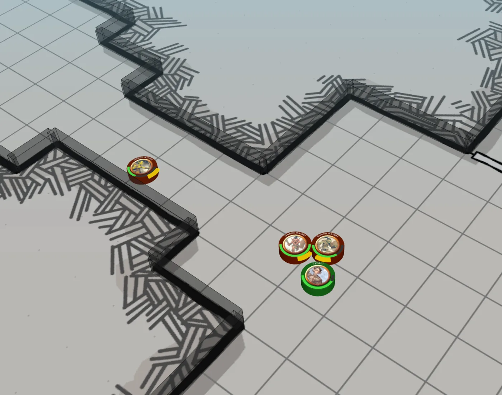

And it was kind of working! After designing the instancing strategy though, I realized that there's
no reason I couldn't have open-world zones that were _also_ instances, capped at ~50 characters at
a time (I didn't realize yet then that that's a standard strategy, which WoW calls 'layers'). So I
got happily to building, generating sets of icons, heaps of simple orthographic images for objects to
stamp onto maps, and sorting out hundreds of tokens from TooManyTokens. But.. making the maps themselves
was _so slow and painful_. I was using Inkarnate, which is a solid tool, but hand-building maps was
super time-consuming, partly because _I'm bad at that_. After I made half a dozen maps, and started
realizing just how many I needed to make a reasonable-sized first "zone", I felt brief despair, but
Watabou's map generators looked like just the tool I needed!

So I spent some time learning about map generation, and generated vector art like they used, and
produced something _pretty decent_. But the images were huge, so instead I started distributing the
map's base data, and having the _client_ construct the image (took about 12ms). And I got all the
way to "combat works, though it's not very balanced" and "looted equipment with functional stats"
when I realized.. this game was _bland_. Everything looked kind of the same - it was very difficult
to create any visual identity when the generator owned much of the look and all the units were tokens.

So I took a short break, and built something else I was wishing for - I occasionally use Tabletop Simulator
to play board games with friends in other states, and it's kind of heavy; what I wanted was basically
the same capability, but with the physics cut off, and able to run in a browser (I specifically wanted
to play The Elder Scrolls: Betrayal of the Second Era with a friend of mine). So I took a swing at that,
and learned about 3D rendering in the process..

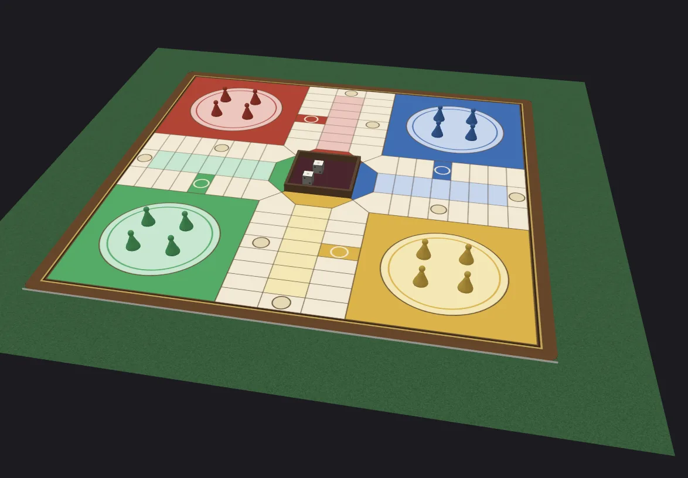

When I finished building that, I had some _ideas_, so I spiked a 3D rendering of some generated landscape
(learned a _lot_ about performance optimizations in WebGL), and the results were promising.

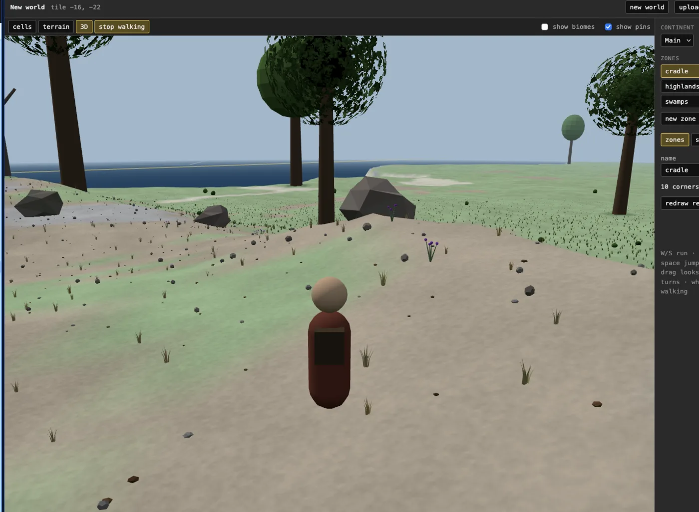

So I dove in - this time I _knew_ the effort was all going to be the content generation, so I started
off with a focus on building the tools to do it with.

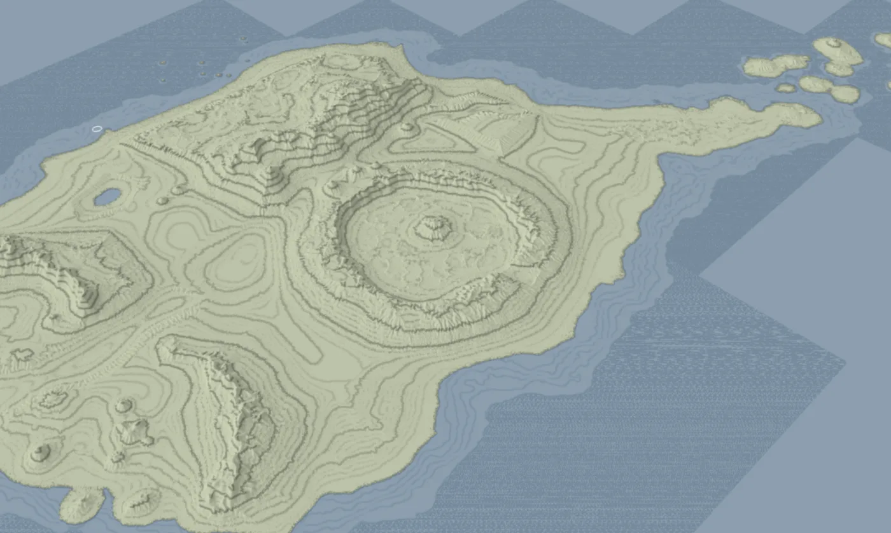
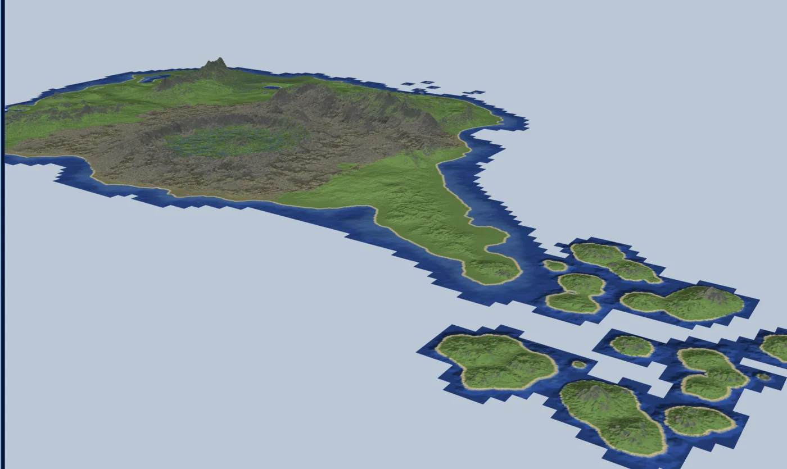
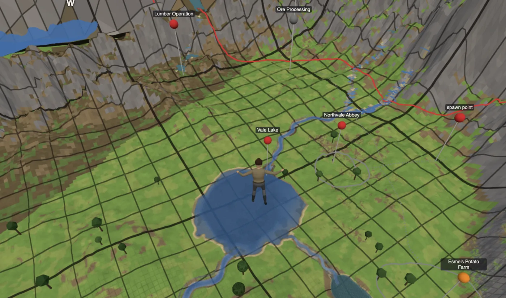

I recently spent a fair amount of time working out a reasonable way to represent and edit _caves_
in my terrain, because I was utterly unsatisfied with the experience on the first several
implementations I tried. I ended up with a smoothed voxel-based solution, where you lay out
the cave at large scale with one set of tools, then "bake" it, so you can do further detail-editing
with Minecraft-style voxel management and object placement. I'm not confident that's the final system,
but it certainly works well enough for now!

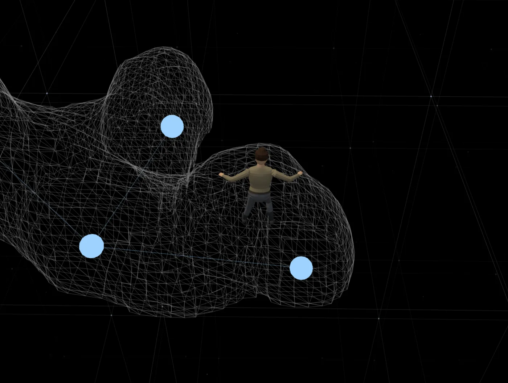
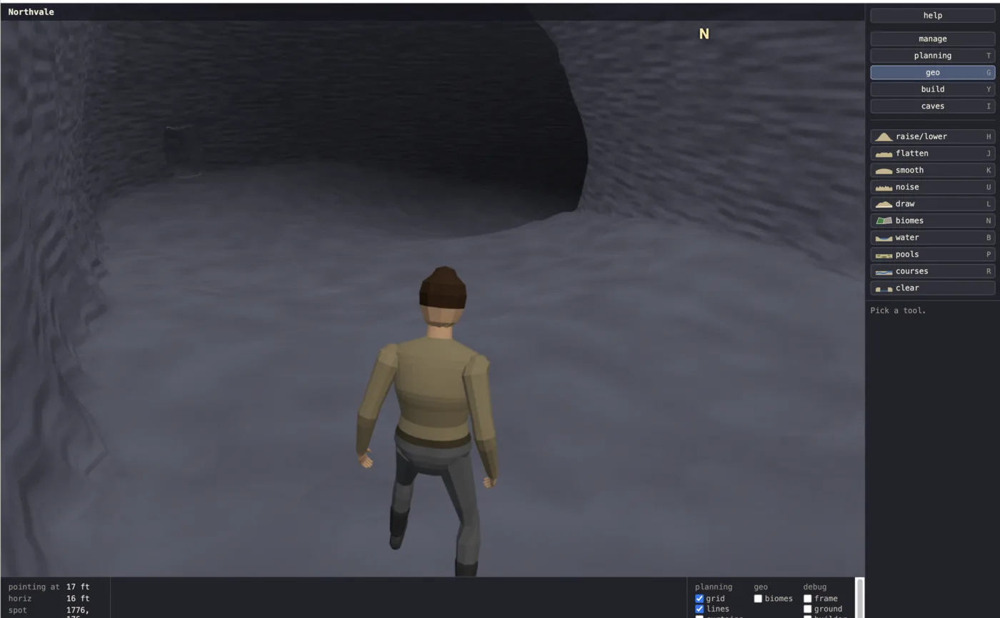
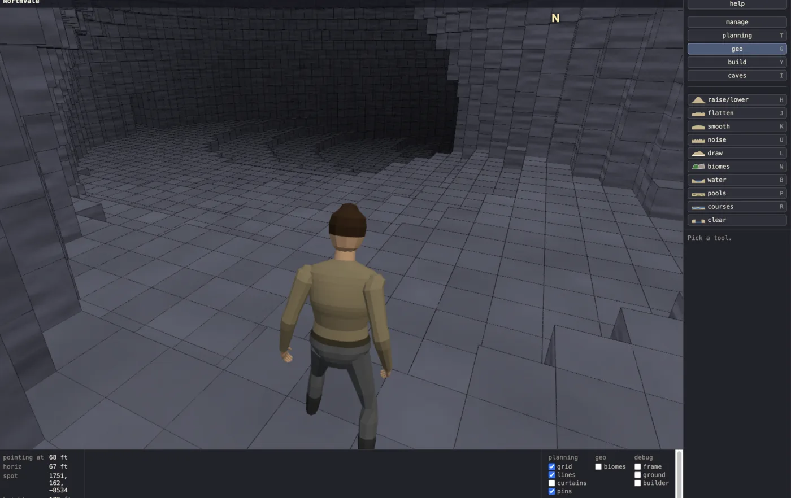

The biggest pain point was in the _interface_ between the 'cave tiles' and the 'terrain tiles' - I used
different formats and scales for them, and it turns out that blending the rendered heightmap terrain
into the rendered _smoothed-voxel_ caves was.. not straightforward. It still doesn't look amazing, but
apparently this is why other games always seem to cover the outlines of the entrances to caves with
art..

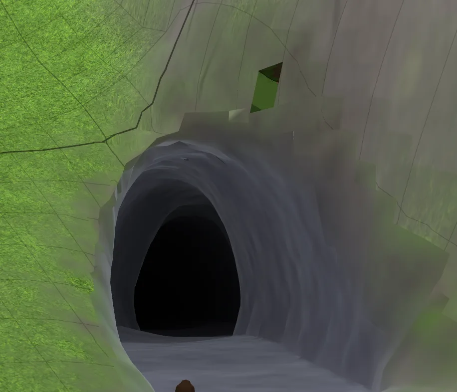

Right now I'm working on class/ability implementation, including more animations, particle effects,
and making abilities all _work_ (on a training dummy - no actual monsters until milestone 3). But I'm
happy with how it looks for the moment!

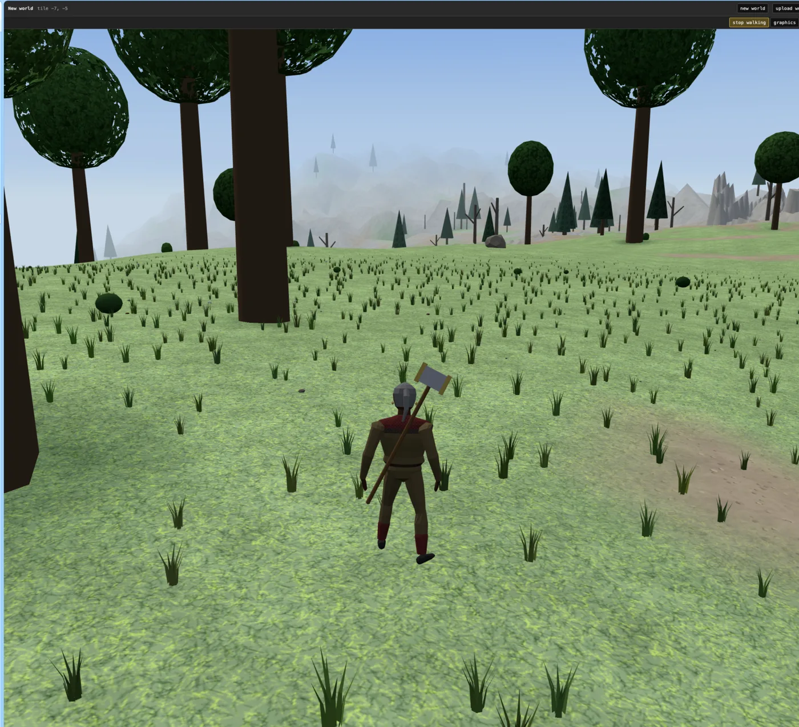
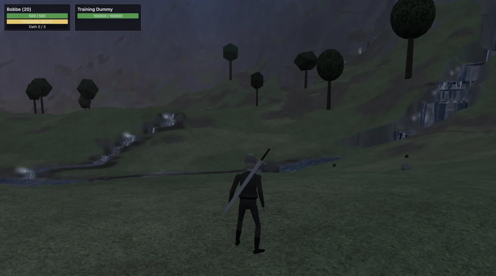
