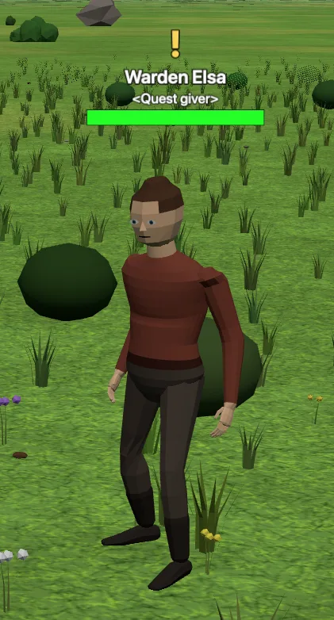
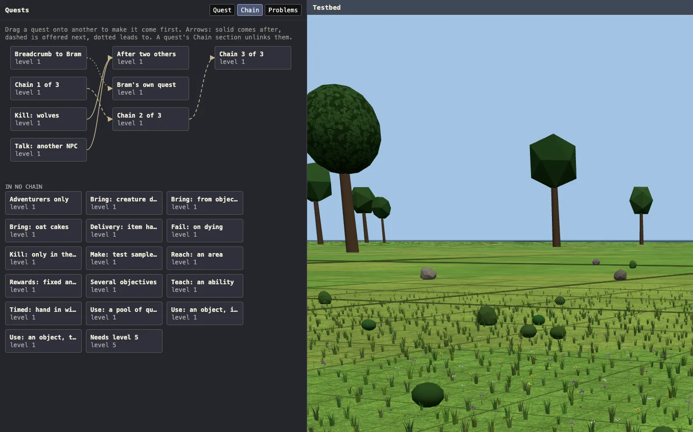

I've got terrain, I've got buildings, I've got monsters, I've got NPCs. But the _most important thing_
in the player experience, the concept that drives movement and creates shape, is still missing. Players
can wander as they like, but without _goals_, that wandering is more an appreciative meander than part
of a **game**. And.. Delve isn't really pretty enough for experiential play.

{: style="margin-inline: auto"}

MMO quests have a huge number of possible shapes, but much of that is a long tail - there is a much
smaller set of shapes that are frequently used in existing games like Veloren, World of Warcraft, Skyrim,
and Guild Wars. And there's (helpfully) an actual _academic community_ focused on real-world game
structure, which has made a bit of a study of quests.

"Fetch me Thing." "Talk to Person." "Kill some Monsters." "Collect 12 Objects." "Take Thing to Person."
"Action 4 Things on the ground." "Go find Place." "Use this on 5 Monsters." There are variations, but
these patterns cover about 90% of the quests in my datasets. Chained together, with explanatory text,
and with surrounding _context_, those are enough. There are a few more we'll need to implement later
(after Professions and Dungeons exist).

And.. conspicuously absent, "Escort me to Place." I'm not sure who remembers what escort quests were
like in vanilla WoW, but "terrible" is probably the best overall word. They're _still_ annoying to
execute, in basically every game that has them (though Skyrim's approach of turning escorted characters
into a sort of follower/minion is the least painful), but in _early_ games, escort quests actually
involved the one copy of an NPC walking slowly through scripted events. That's a natural implementation
(and the one I'd need to use, since I don't have phasing of any kind), but the consequence was that
during the entire escort, _nobody else could get the quest or attempt it_. So.. maybe we'll add these
later, but they're complex to build (as a Builder), and difficult to implement well.

## The Pain

Building quests as a content creator is _too much work_. If you've used RPG Maker, or some other similar
system, you've felt the pain - you're trying to build a coherent story, but every part of that story
needs to be considered in isolation, because quests generally don't know about each other in any sense
except as prerequisites - "chains" aren't really a concept in any of the systems I've used, or at
least not one with much affordance.

Delve implements a "Chains" view that shows quests as a directed (acyclic, clearly) graph, so you can
work on the Quest Chain itself, jumping around the map to see the involved NPCs and locations, but
using the quests as the navigation tool instead of the world and map.

## LLMs

Claude can write quests and chains. They're just very bland and boring (except when they get **weird**).
But writing a thousand quests by hand is a huge amount of work. Zones tend to have between 30 and 80 quests,
and quests are _highly_ configurable, such that setting up that many quests should be 4-8 hours of work
_even if you already have them figured out_. But they _are_ just configuration data, for the most part,
and my position on this game has so far been "It should be reasonable for a human to do, but it should
also be easy for an LLM to work with."

I intend to have dozens of zones in my initial world, and I do _not_ want to spend hundreds of hours
writing quests. Or doing anything, really - I'd like zones to take a few hours each to make, once the
tools are finished. That _requires_ building tooling and workflows that LLMs can participate in. My
target workflow _here_ is to start by describing places and their connecting routes, defining intended
progression paths through the zone, listing major chains (probably 3-6 per zone), and then spitballing
side quests in plain language. Claude is then engaged as a consultant, fleshing out the details of
quest objectives, determining the central NPCs, and confirming the pacing and XP progression. Then comes
the actual content - defining simple descriptions and personality quirks in a conversation, then
writing dialogue and quest descriptions for each of the quests in appropriate tones. I'm personally
only an _adequate_ writer, and I have trouble writing in more than a few distinct voices, but for
_short snippets_ like this, Claude is actually quite good (its writing problems show up in longer work,
because it loses consistency over time, in tone, characterization, and continuity).

So the tooling supports that approach. The Layout tools let you specify Hubs and Camps, and draw
travel connections between them (generally following roads and paths, or vice versa). You can define
"areas" (raw polygons on the world) in the map editor, and use those areas to specify regions of
interest, spawn areas, object pools, etc. And the quest format itself is a single JSON file of quests,
which `jq` can pick through by zone and region, so the content is approachable as geography and content
without actually needing to render anything or understand the geometry and context.

I will be learning as I build here; I'm not confident this approach is right yet. But I have a good
feeling!
